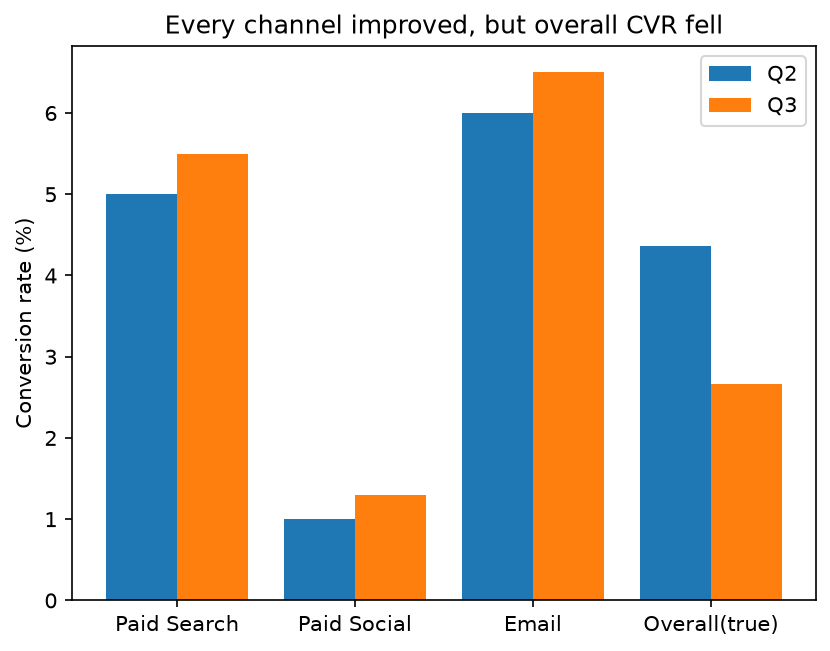

# The lying campaign dashboard: a conversion-rate audit (paid media)

**Business problem:** the paid-media dashboard reported "conversion rate up: 4.43% vs 4.00%" and proposed moving more budget into Paid Social. Bookings had fallen. Is the KPI right?

**Data:** `data/channel_quarters.csv`: sessions and conversions for 3 channels (Paid Search, Paid Social, Email), Q2 vs Q3 (synthetic).

**Method**
1. CVR per channel = conversions ÷ sessions (returns `None`, not 0, when there are no sessions).
2. Dashboard CVR = average of the channel rates (every channel weighted equally).
3. True CVR = total conversions ÷ total sessions, i.e. a **weighted** average where each channel counts by its share of traffic.
4. Explain the gap: change in channel mix (Simpson's paradox).

**Result**

| Quarter | Dashboard CVR (avg of rates) | True CVR | Paid Social share of sessions |
|---|---|---|---|
| Q2 | 4.00% | 4.36% | 18% |
| Q3 | 4.43% | 2.67% | 69% |

Every channel improved (Search +0.5 pp, Social +0.3 pp, Email +0.5 pp), yet the true CVR fell by 1.69 pp (−39% relative). The cause is the mix shift into the weakest channel, which cost about 280 bookings in one quarter (≈628 at Q2's mix vs 347 actual).

**Recommendation:** fix the dashboard formula (total conversions ÷ total sessions) and don't move more budget into Paid Social on the basis of CVR. See [`memo.md`](memo.md).

**Limitations:** CVR is not profit: no cost or revenue per channel yet (CPA/ROAS needed). Two quarters only, so no uncertainty estimate yet (confidence intervals come in Phase C).

**How to run:** `python3 audit.py` (Python 3.10+, `matplotlib`). Prints both CVRs per quarter and saves `cvr_audit.png`.
